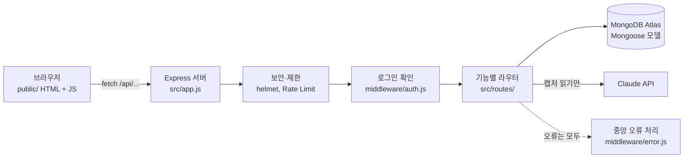
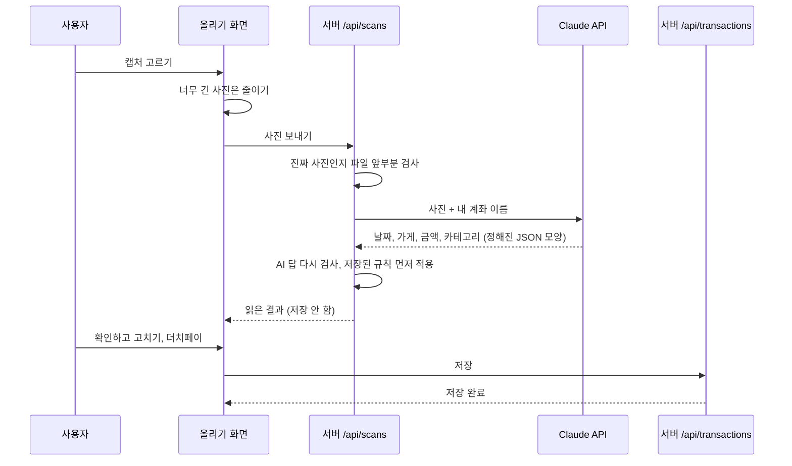

# 시스템 구조

코드를 처음 보는 사람이 전체 모양을 잡을 수 있게 정리한 문서예요. (10강 시스템 아키텍처 위키) 코드 구조가 바뀌면 이 문서도 같이 고쳐요.

## 한눈에 보기



- 화면 파일과 API를 **같은 서버**가 보내요. 주소가 같아서 CORS 설정이 필요 없어요.
- 로그인한 사람의 id는 `req.userId`에 들어 있어요. 모든 DB 조회에 이 조건을 넣어서 남의 데이터가 섞이지 않게 해요.
- 라우터에서 `throw new HttpError(400, '메시지')`를 하면 중앙 오류 처리가 JSON으로 답해요.

## 캡처를 올리면 일어나는 일



사진은 서버 메모리에서만 잠깐 쓰고 어디에도 저장하지 않아요.

## 함께 개발하는 방식: API 계약

프론트와 백엔드가 서로 기다리지 않게 **API 형식을 먼저 정해 두는 방식**을 써요. (10강 Contract-Driven Development)

| 역할 | 파일 |
|---|---|
| 계약서 | `docs/API.md` (요청·응답 모양) |
| 가짜 응답 (Mock) | `public/js/mock.js` (API가 없을 때 화면이 쓰는 예시 데이터) |
| 계약 검사 | `test/contract.test.js` (API가 계약대로 답하는지 채점) |
| 연습 데이터 | `src/devSeed.js` (임시 DB에 연습 계정과 거래 생성) |

## 폴더

```
src/
  app.js            서버 설정 (미들웨어, 라우터 연결, 404)
  server.js         서버 시작, 임시 DB면 연습 데이터 생성
  config.js         .env 읽기
  db.js             MongoDB 연결 (주소가 없으면 임시 메모리 DB)
  devSeed.js        연습 계정과 예시 거래
  categories.js     카테고리 목록
  middleware/       로그인 확인(auth.js), 오류 처리(error.js)
  models/           DB 모양
  routes/           API (기능마다 파일 하나)
  services/         규칙 기억(rules.js), 고정비 판별(fixedCosts.js), 캡처 읽기(scanner.js)
public/             화면 (HTML, CSS, JS)
data/               카테고리, 청년 정책 목록
docs/               명세서, API, 설명서, 협업 문서
eval/               캡처 인식 정확도 재기
test/               자동 시험
```

## DB

| 모델 | 내용 | 담당 기능 |
|---|---|---|
| User | 아이디, 암호화된 비밀번호 | F0 |
| Account | 계좌·카드 이름, 은행·카드사, 용도 | F1 |
| Setting | 월 예산, 고정비 목록 (사람마다 하나) | F4 |
| Transaction | 날짜, 가게, 내 몫, 원래 금액, 사람 수, 카테고리, 지출 여부 | F2, F3 |
| Rule | 가게 이름 → 카테고리 (고친 분류 기억) | F2, F3 |

날짜는 `"2026-11-03"` 같은 글자로 저장해요. 시간대 때문에 날짜가 하루 밀리는 문제를 막으려는 거예요.

## 지키는 보안 규칙

- 비밀 값은 `.env`에만 둬요. 배포 서버에서는 환경변수로 넣어요.
- 클라이언트가 보낸 값과 AI의 답은 서버에서 다시 검사해요.
- 화면에 글자를 넣을 때는 `el()`을 써요. `innerHTML`에 사용자 입력을 넣지 않아요.
- 보안 헤더(helmet, CSP)가 인라인 스크립트와 `style="..."` 속성을 막아요.
- 캡처 읽기는 사람별 시간당 30회, 전체 시간당 200회까지예요.
